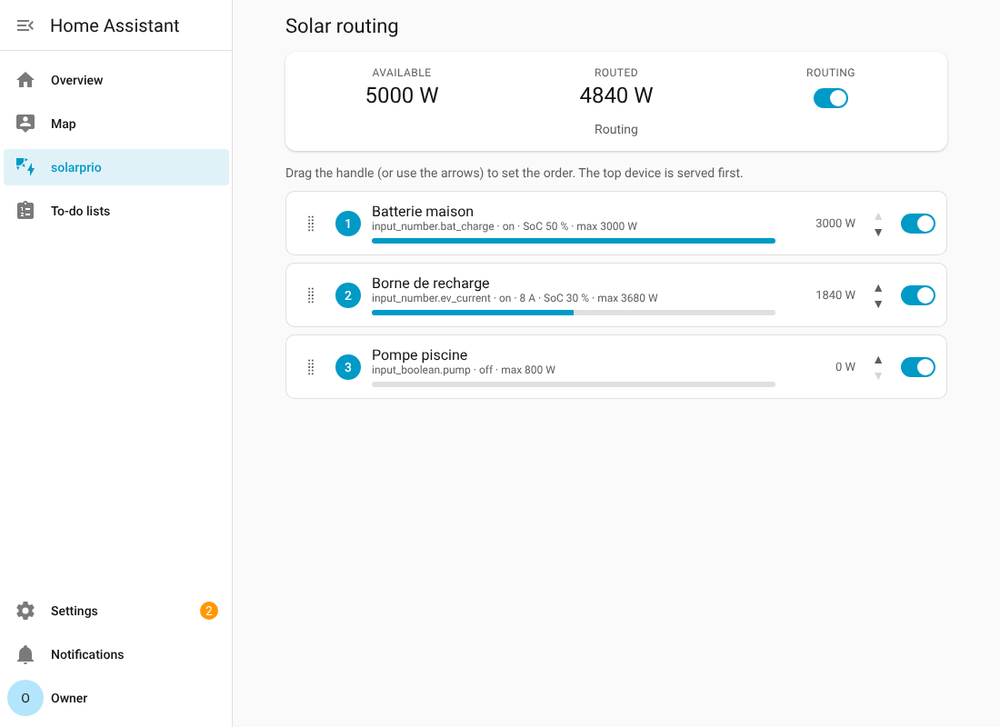

# solarprio

**Route your solar surplus where you want it, in the order you choose.**
Set the priority of your loads (water heater, EV charger, battery, heat pump...) by dragging
them in a list, and the surplus flows to them automatically. Open source, works inside Home Assistant
or standalone in Docker.



> **Status: alpha (0.1).** It works in automated tests and against a real Home Assistant with simulated
> devices. It has **not** been run on a real installation with real inverters, batteries or wallboxes.
> See [What is and is not verified](#what-is-and-is-not-verified) before you trust it with your hardware.

## Safety

This software switches electrical loads. It is **not a safety device** and comes with no warranty
(see the license). Electrical work belongs to qualified people.

- Keep your hardware's own protections (breakers, thermal cut-offs, charger and battery management systems).
  Do not rely on this software to protect a load.
- If the power measurement is lost, loads are switched **off** by default (`on_stale`); a battery charge
  setpoint goes to 0 W. Read [Device types](#device-types) for what that means for your equipment.
- Test with a low-risk load first and watch it before leaving it unattended.

## Features

- **One ordered list** of devices; drag to change priority, takes effect immediately without switching anything off.
  Add, edit and delete devices, and change the measurement settings, from the same panel.
- **Device types:** on/off loads, adjustable loads (dimmer, router), batteries, EV chargers, and computing tasks (a "go"
  signal that never switches a power supply, see [docs/TASKS.md](docs/TASKS.md)).
- **Central regulation:** all the decisions are in solarprio (tank temperatures, off-peak, sanitary minimum, subscription
  cap, smooth ramps, emergency cut), for every heater and variable load at once; a low-cost solar router only has to be an
  actuator. Ready-made models for water heaters. See [docs/REGULATION.md](docs/REGULATION.md).
- **Ready-made models by brand:** a catalog of profiles (Victron EV Charging Station and grid measurement, generic water
  heaters), each saying honestly how far it was verified. Anyone can add one with a JSON file, no code: see
  [docs/PROFILES.md](docs/PROFILES.md).
- **Many devices:** any number, started together when the surplus allows; setup pre-filled from the Home Assistant Energy
  dashboard, with import and copy of devices. See [docs/MANY_DEVICES.md](docs/MANY_DEVICES.md).
- **Router and manager:** the off-peak hours are set once for the whole site and each device chooses to follow them; a forced
  run charges a car or a battery from the grid on demand; everything fed from the grid stays under your subscription limit.
- **Off-peak top-up:** during your off-peak hours a device is fed from the grid until it stops consuming (a hot water
  tank), then the next device takes its turn. See [docs/OFFPEAK.md](docs/OFFPEAK.md).
- **Safe by default:** minimum run/rest times, start margins, hysteresis, loss-of-measurement handling,
  everything switched off on shutdown.
- **Home Assistant integration** with a sidebar panel (English and French) or a **standalone Docker runtime**
  (MQTT and HTTP) with the same engine.
- The engine is plain Python with no Home Assistant dependency, and is tested in isolation.

## Install

### Home Assistant (HACS, custom repository)

[](https://my.home-assistant.io/redirect/hacs_repository/?owner=Melvilh&repository=solarprio&category=integration)

The button needs [HACS](https://hacs.xyz); My Home Assistant links are reported to need `default_config:` or `my:` in
your Home Assistant configuration. The badge image and the link could not be tested from the development environment.
Without the button:

1. In HACS, open the menu (three dots) > **Custom repositories**.
2. Add `https://github.com/Melvilh/solarprio` as type **Integration**, then **Add**.
3. Download the integration from HACS and restart Home Assistant.
4. *Settings > Devices & services > Add integration > solarprio.*

Step by step, in French: [docs/DEMARRAGE_FR.md](docs/DEMARRAGE_FR.md).

Manual install: copy `custom_components/solarprio` to your Home Assistant `config/custom_components/`
and restart.

Setup: pick the grid power sensor (positive = export; or production + consumption sensors), then use
**Configure** to add devices. Pick a ready-made model or a type, then fill the form (entity pickers, same look as Home Assistant). A **solarprio**
entry appears in the sidebar (admins only) to order devices by drag and drop (mouse, touch, or the arrows),
enable or disable each device, and turn routing on or off.

> The icon in `brand/` is used by Home Assistant 2026.3 and later. On earlier versions the integration
> works but shows a generic icon.

### Standalone (Docker, no Home Assistant)

```bash
cp config.example.toml config.toml        # edit topics, powers, devices
docker compose -f docker-compose.example.yml up --build
```

or `pip install ".[runtime]" && solarprio --config config.toml`.

The runtime reads your meter from MQTT, decides, and publishes commands to MQTT topics or calls HTTP URLs.
On `SIGTERM` / `docker stop` it switches all loads off before exiting.

## Device types

| Type | Command | Specifics |
|---|---|---|
| On/off | switch | start margin, stay tolerance, min on/off times |
| Adjustable | light / number | percent or watts, minimum power |
| Battery | number (charge setpoint, W or %) | stops at a state-of-charge limit and resumes a few % lower; optional SoC and measured-power sensors |
| EV charger | number (current, A) + optional on/off switch | never below the minimum current (6 A by default, IEC 61851-1), whole-amp steps, fixed 1 or 3 phases, optional plugged-in, SoC and measured-power entities |

Behaviours worth knowing:

- A **full battery** (or a car at its target) stops asking for power, so the surplus goes to the next priority.
- An **unplugged car** gets nothing and does not reserve surplus. Unknown plug state counts as plugged.
- With a **measured power** entity, the engine uses the real consumption instead of the command, and frees
  the difference for lower priorities when a device takes less than commanded (a tapering battery) after a settle time.
- A SoC limit below 100 % **without a SoC sensor means no charging** (the limit cannot be checked).
- When routing stops (switch off, measurement lost, HA stops) every device gets 0: **a battery's charge setpoint
  goes to 0 W**, so a battery that normally charges by itself will not until routing resumes.
- Without an on/off switch an EV charger is paused with 0 A, which not every charger accepts.
- A sensor that only reports on change (some Zigbee meters) can be treated as lost after `stale_after_s`;
  raise that setting for such sensors.
- **Not supported:** automatic 1-phase/3-phase switching (hardware specific; some chargers need a re-plug to
  go back to 3 phases), discharge control of the battery, charging a battery in two priority stages.

## Hardware notes

- **Victron** (GX device, Multi / Quattro, EV Charging Station): see [docs/VICTRON.md](docs/VICTRON.md),
  `config.victron.example.toml` and the profiles `victron-grid` / `victron-evcs` (`examples/victron-profile.toml`). Built from Victron's documentation and tested only against a simulated GX device.

- **ESPHome solar router** (triac / SSR for a water heater): see [docs/ESPHOME_ROUTER.md](docs/ESPHOME_ROUTER.md) for
  letting solarprio set its power, with a watchdog. Checked with `esphome config`; the C++ was not compiled and nothing
  was run on hardware. A complete water-heater example (Linky with separate withdrawn and injected sensors, export
  margin) is in [docs/WATER_HEATER_EXAMPLE.md](docs/WATER_HEATER_EXAMPLE.md).

## What is and is not verified

Verified by automated tests: the allocation engine (including mutation checks on the safety rules), the
standalone runtime against a real MQTT broker (a Python test broker, not Mosquitto), the Home Assistant
integration against Home Assistant 2026.2.3, and the panel in real Chromium against a real Home Assistant instance
(drag and drop, persistence, switches, battery and EV scenarios) with **simulated** entities and meters.
`hassfest` and the HACS manifest schemas pass.

Only Home Assistant 2026.2.3 was tested, so `hacs.json` asks for 2026.2.0 or later; the lower bound can be relaxed once older versions are tested.

Not verified: real inverters, batteries and wallboxes; the Docker image build (no Docker daemon was available
during development); Mosquitto; touch devices, Safari and Firefox; Home Assistant versions other than 2026.2.3;
the GitHub workflows (they cannot run until the repository is on GitHub).

## Develop

```bash
pip install -e ".[dev]"
pytest                      # core + standalone runtime
python scripts/sync_core.py # after editing src/: refresh the copy used by the HA integration
scripts/test_ha.sh          # Home Assistant integration tests (needs .venv-ha, see CONTRIBUTING.md)
scripts/e2e_ha.sh           # real Home Assistant + real Chromium driving the panel (slow)
```

See [CONTRIBUTING.md](CONTRIBUTING.md) and [docs/ARCHITECTURE.md](docs/ARCHITECTURE.md).

## Make it work with your hardware

Something does not work, should work differently, or you want your hardware supported? The panel has a link at the bottom, and
[the issue forms](https://github.com/Melvilh/solarprio/issues/new/choose) (English or French) send your request to the right
place: a problem, an improvement, or "make it work with my hardware".

The project is meant to grow with what people own. A brand- or model-specific profile (one JSON file) or a tested
configuration and a short page is already a contribution (no code needed): [docs/PROFILES.md](docs/PROFILES.md),
[docs/ADDING_COMPATIBILITY.md](docs/ADDING_COMPATIBILITY.md). What is known to work, and how well it
was verified: [docs/COMPATIBILITY.md](docs/COMPATIBILITY.md). Ideas and open work: [docs/ROADMAP.md](docs/ROADMAP.md).

## License

Apache License 2.0, see [LICENSE](LICENSE). The project name and logo are not covered by the license.

This is an independent community project. It is not affiliated with, endorsed by or supported by Home
Assistant, Open Home Foundation or Nabu Casa. "Home Assistant" is used only to describe compatibility.
